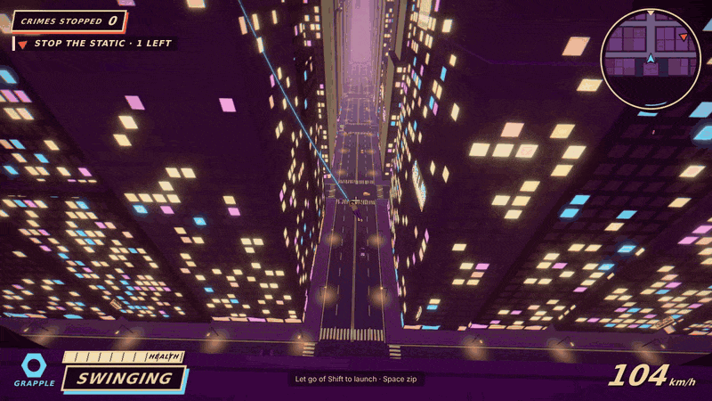
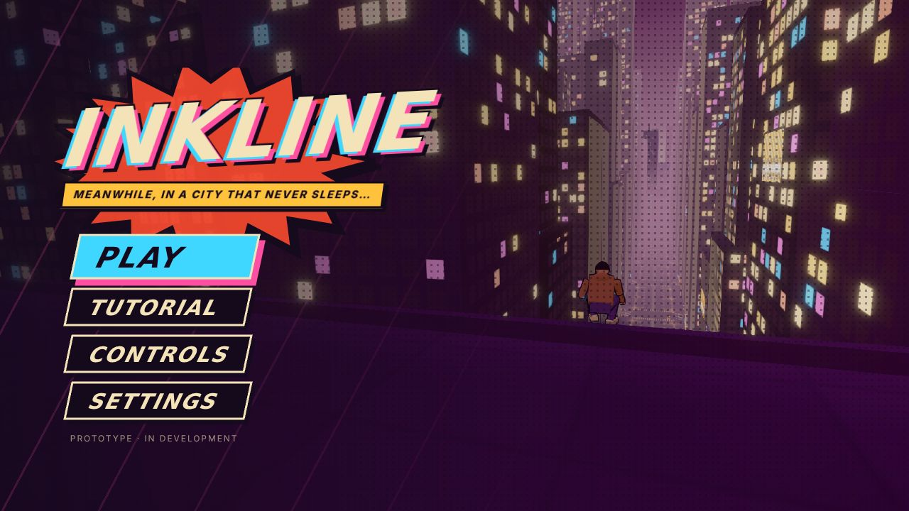
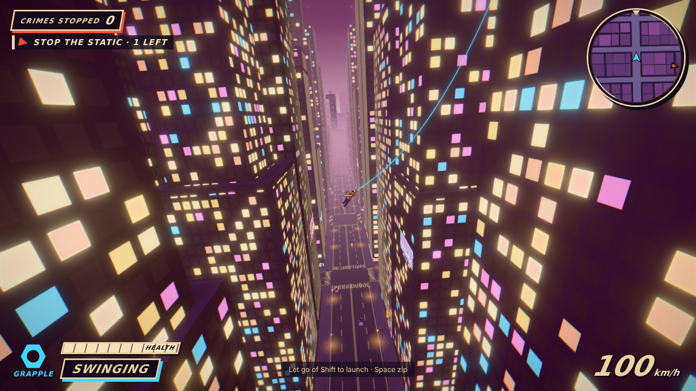
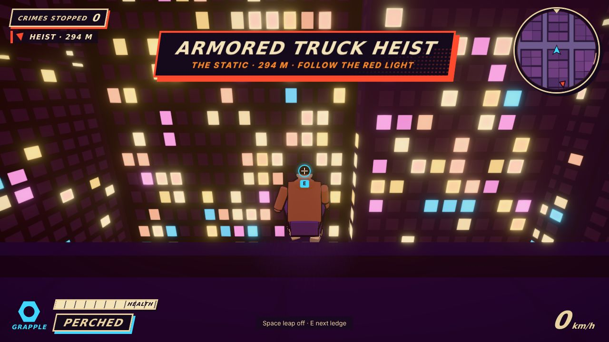
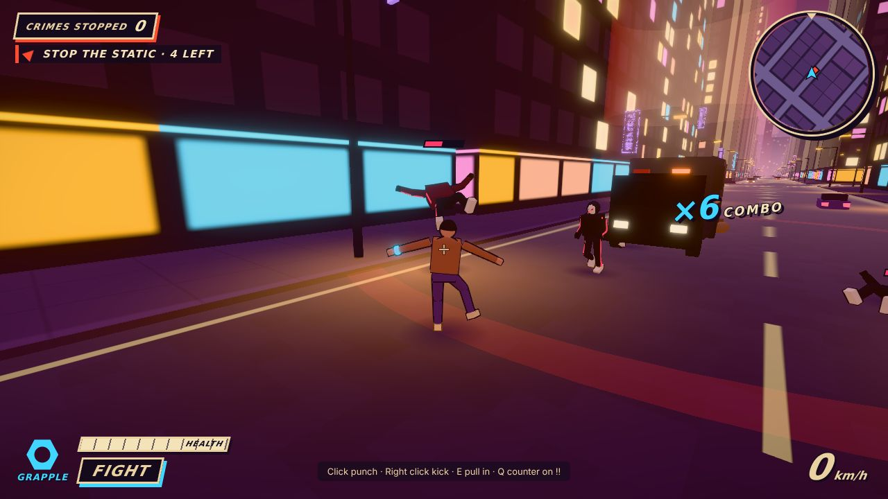
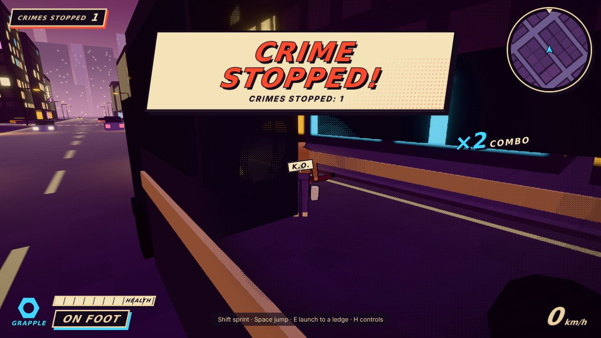

# Inkline

A comic-book open-city action game that runs in the browser: swing, wall-run and fight across a procedurally generated night city.

**Play:** <https://sixoctober.vercel.app/> · Status: in development (prototype) · Desktop Chrome/Edge, keyboard + mouse.



| | |
|---|---|
|  |  |
|  |  |



## Features

- Physics-based rope swinging with automatic anchor selection, plus zip and launch-to-ledge
- Wall running and climbing; dive and ground pound
- Two switchable modes, Grapple and Titan, also mid-air
- Crime-and-combat loop: punches, kicks, combos, counters and rope pulls
- Comic-book HUD and effects
- Procedurally generated city (`?seed=123` builds another one)

## Controls

| Key | Action |
|---|---|
| W A S D | Move (relative to the camera) |
| Mouse | Look around · Wheel: camera near / mid / far |
| Shift | Sprint · hold in the air to swing |
| Space | Jump (hold: higher) · in the air: zip |
| E | Launch onto the ledge under the crosshair · Grapple, on an enemy: pull them in |
| C | Dive (in the air) · Titan: ground pound |
| Tab · 1 · 2 | Switch Grapple / Titan |
| Titan: Space | Hold, then let go: super jump |
| Left / right click | Punch / kick (3 in a row: combo with a finisher) |
| Q | Counter when an enemy shows **!!** |
| R | Back to the last safe spot |
| T | Slow motion |
| H | Show / hide the controls card |
| F1 | Tuning panel |
| Esc | Pause |

## Tech

TypeScript, Three.js, postprocessing, Vite, Vitest, Vercel.

## How it's built

Designed and directed by Emirhan Efe Yaşar; implemented with AI coding agents (Claude Code, Codex) through a staged roadmap, with playtest feedback after each stage.
The repository has 120 automated tests (Vitest) covering movement, rope and grapple, camera, combat, mode switching, the city generator and settings.

## Run locally

Node.js 22.12 or newer.

```bash
npm install
npm run dev
```

Other scripts: `npm run build`, `npm run preview`, `npm run test`, `npm run typecheck`.

Original characters, city and art; no third-party characters or assets.

## Project documents (Turkish)

[BRIEF.md](BRIEF.md) (game brief) · [PLAN.md](PLAN.md) (roadmap) · [NOTLAR.md](NOTLAR.md) (session notes) · [docs/art-direction.md](docs/art-direction.md) (art direction).
Headless smoke tests and the Blender test figure are described in [AGENTS.md](AGENTS.md).
